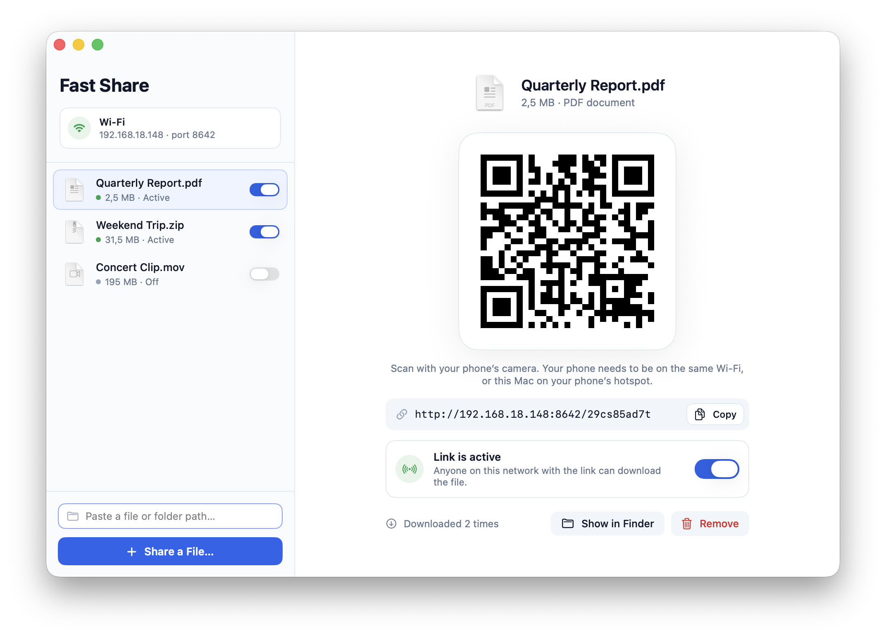
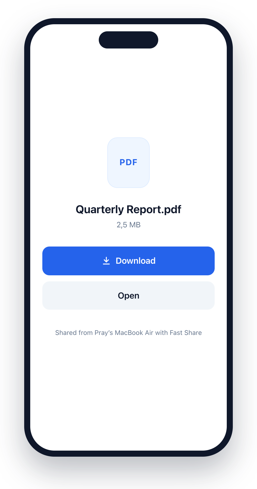

# Fast Share

A native macOS app for sending files from your Mac to your phone over the local network: the same Wi‑Fi, or the Mac connected to your phone's hotspot. Every shared file gets one link and one QR code, and each link can be switched on or off.

<p align="center">
  
  
</p>
<p align="center"><sub>The Mac app, and the page your phone opens after scanning the QR code.</sub></p>

## Build

Requires macOS 14 or later and a Swift 6 toolchain (Xcode, or just the Command Line Tools: `xcode-select --install`).

```sh
scripts/build-app.sh            # builds build/Fast Share.app
scripts/build-app.sh --install  # same, then copies it to /Applications
scripts/test.sh                 # runs the tests
```

## Use

- **Share a file:** click **Share a File…** (⌘O), drop files on the window or the Dock icon, or use Finder › Open With › Fast Share.
- **Share by path:** paste or type a path into the field above **Share a File…** and press Return. It accepts absolute paths, `~/…`, `file://` URLs, quoted paths, and paths copied from Terminal with escapes like `My\ File.zip`. The field is focused when the window opens, so you can paste and press Return straight away.
- **Folders are zipped automatically:** share a folder and Fast Share zips it in the background (the zip has the folder at its top level, and Mac-only metadata is left out). The QR code appears when the zip is ready, and you can cancel a big zip from the sidebar. Sharing the same folder again re-zips it under the same link. One link always serves one file.
- **Show the QR code:** click a file in the sidebar and the main page shows its QR code and link. Scan it with your phone's camera to open a page with **Download** (plus **Open** for photos, videos, audio, PDFs and text, so you can view them in the browser or save them to your library).
- **Turn a link on or off:** use the switch in the sidebar row or on the main page. While a link is off, your phone gets "This link is turned off". Turning it back on restores the same link.
- **Remove** deletes the link, never your file or folder. For a zipped folder it also deletes the zip.
- **Change networks:** links use the Mac's current IP address, so the QR code updates by itself when you move between Wi‑Fi networks or join your phone's hotspot. If the Mac is on more than one network (say Wi‑Fi and iPhone USB), choose one from the menu on the network card.
- **Keep sharing in the background:** closing the window keeps links working; quit (⌘Q) to stop sharing.

## How it works

- `Sources/FastShareCore` is a small HTTP/1.1 server built on Network.framework. It listens on every interface on port 8642, falling back to 8643–8660 and then any free port. It streams files in 1 MB chunks and supports `Range` requests (video seeking, resumed downloads), `HEAD`, and keep-alive.
- Links look like `http://<mac-ip>:8642/<token>`. The token is 10 random characters (about 49 bits), so nobody else can guess it.
- `Sources/FastShare` is the app itself: an AppKit window that hosts SwiftUI views, with a forced light appearance.
- Your shares are saved in `~/Library/Application Support/Fast Share/shares.json`. Zips of shared folders are kept next to it in `Archives/` until you remove their link.

## Troubleshooting

- **The phone can't open the link.** Check that both devices are on the same network. Guest and public Wi‑Fi networks often block traffic between devices; use your phone's hotspot instead. If the macOS firewall is on, allow Fast Share when it asks. It asks again after every rebuild, because the app is ad-hoc signed.
- **macOS asks to let Fast Share access your Desktop, Documents or Downloads.** This happens when it reads a file it wasn't handed through the file picker or drag and drop, for example a pasted path, or a shared file after a relaunch. Allow it once per folder.
- **Privacy.** While a link is on, anyone on the same network who has the link can download the file. On public networks, turn links off or quit the app.
